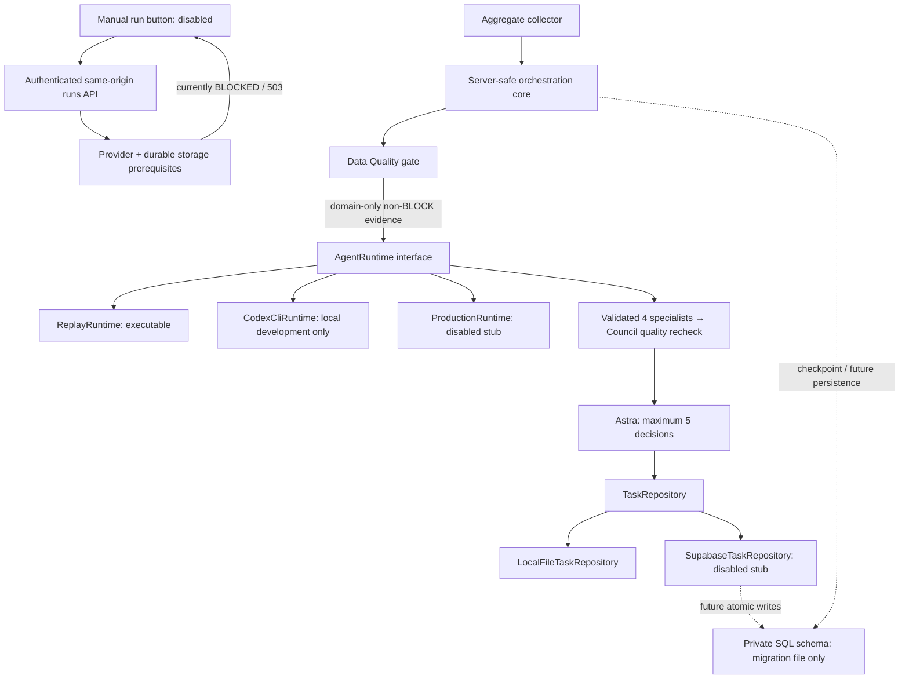

# Digital Operating Layer v2 — architecture / audit draft

Baseline: `800b3ce9d9e062daf907825fd67fdadc11154a7c` (v1 LIVE). Branch: `feature/digital-operating-v2`. No commit/push/PR, migration execution, external LLM invocation or production changes authorized/performed in this stage.

## Executable now

- `orchestrate()` with injected collector/runtime/clock/checkpoint. No CLI/filesystem/env/provider imports in business core. Node server target; not Edge.
- Sequential independent domain packets, cloned at boundary; BLOCK evidence excluded; no peer results passed. Agent result is strictly validated against allowed IDs and schema.
- Lifecycle QUEUED → COLLECTING → QUALITY → SPECIALISTS → COUNCIL → COMPLETED, plus FAILED/BLOCKED. Invalid transitions rejected. Provider failure/timeout fails the run; incomplete specialist coverage is represented as BLOCKED by Council.
- Provider mode mismatch blocked. Replay is always labeled replay. Strict null semantics remain; business priority UNASSESSED is independent of confidence.
- Input older than 24h/future blocked. LIVE requires `currentFingerprint` in the core: missing callback blocks before collection (`FINGERPRINT_REQUIRED`). After all specialists, a fresh aggregate fingerprint is read before Council. Read error, timeout or malformed SHA-256 blocks with `FINGERPRINT_READ_FAILED`; changed fingerprint blocks with `EVIDENCE_CHANGED`. The callback must perform a fresh aggregate read, not hash the original packet. Timeout is bounded by `timeoutMs` (default 180s); cancellation remains a future provider responsibility. REPLAY needs no external callback; if supplied, it is still checked.
- Council repeats quality checks at synthesis time. Checkpoint callback receives metadata only; persistence snapshot revalidates every specialist against its own domain IDs, rejects non-null financial impact, and uses allowlisted aggregates/results. Unknown fields, oversized values and obvious credential/contact strings are rejected. This is defense in depth, not a general PII classifier: source allowlisting and review remain required.
- Local runner uses the same core, atomic artifacts and lock; last-successful is distinct from latest attempt. CLI output scratch files are removed and raw stderr/stdout are not archived. Legacy executive-only invocation is retired; full v2 packets required.
- Local TaskRepository keeps revision conflict and atomic file behavior. Vercel rejects even explicit-path LocalFileTaskRepository access.
- Manual GET exposes availability. POST authenticates, enforces origin, and returns 503/BLOCKED without collection or provider invocation, even when the flag is true.
- UI presents last successful run/mode, quality counts and disabled-action reasons. Technical source dates, SLA, collector/Council times and detailed task eligibility appear in Data Quality / Sources. Legacy artifacts lacking timestamps remain unknown.

## Prepared, not activated

- Migration `supabase/migrations/20261021123211_digital_operating_v2_design.sql`, created via Supabase CLI. Six tables in `operating_private`; no raw RPC/customer/cookie/secret columns. Typed evidence, strict finding JSON shape, run versions/fingerprint, tasks with optimistic revision, task events in the update transaction.
- RLS enabled on all six tables, no browser policies, public/anon/authenticated privileges revoked. Private schema must stay outside Data API exposure. Future service-role/direct DB path remains server-only. [Supabase RLS guidance](https://supabase.com/docs/guides/database/postgres/row-level-security).
- Task INSERT must exactly match the referenced current LIVE Council problem/recommendation/evidence/impact; UPDATE cannot change these fields or task identity/source/created_at (null-safe comparisons). Findings permit at most 40 entries, 64 evidence IDs per finding, 200 characters per ID/key, 4000 per insight/action/impact_basis and 64KB total; IDs must be nonblank strings and impact must be JSON null.
- Current task source means the latest eligible completed LIVE run visible to the transaction: finished_at within the last 24h and not in the future, ordered by finished_at DESC, started_at DESC, run_id DESC (deterministic ties). Selection is independent of Council items: no fallback to an older run if the current run lacks the requested recommendation. Replay is never eligible. This is a latest-run gate, not a substitute for the future server-side fresh-fingerprint check. Concurrent completion/task insertion still needs staging transaction/isolation verification before activation.
- No default-privilege mutation or dedicated-role assumption. Every created private table, identity sequence and function has an explicit PUBLIC/anon/authenticated REVOKE in the same transaction, followed by narrowly scoped server grants. Every future private migration must repeat this object-by-object rule, enable table RLS and keep the schema outside PostgREST; review/tests must inventory all newly created objects. No shared creator defaults or unrelated schemas are changed.
- SQL is design only and has NOT been executed against any database, including local. Static contract tests are not proof of SQL syntax, grants or runtime RLS. Staging PostgreSQL integration tests and security review are prerequisites to approval.
- `source_as_of` is the oldest known source date, not collector timestamp; per-evidence dates and missing sources remain explicit. Fingerprint is SHA-256 over canonical evidence excluding fetched_at; changed values/periods/quality metadata invalidate decisions.
- `SupabaseTaskRepository` is an intentionally unavailable implementation of the interface. No credentials/client/REST calls. Future implementation must map to private tables via server DB transaction, enforce current live recommendation/fingerprint, compare expected revision, and atomically record events.
- No durable RunRepository, lease recovery, provider cancellation, automatic retries or scheduler yet. Local checkpoints support inspection; they do not claim production crash recovery or resumability.

## Before first real LIVE Council

1. Kostiantyn approves a provider/model, aggregate-only data scope, maximum cost/time per run and who may run it. Configure credentials in server secret storage, never chat/Git/client env.
2. Implement the chosen provider behind AgentRuntime with timeout/cancellation, response validation and no business-write tools. No provider is chosen/hardcoded now.
3. Approve staging migration validation, private-schema access model, retention and task ownership; then separately approve production migration if desired.
4. Implement durable run checkpoints/lease recovery and Supabase task repository transactions; test RLS, concurrent revisions, dedupe and failure recovery in staging.
5. Wire authenticated manual flow to durable storage with a fresh fingerprint recheck; only then separately enable the feature flag for one bounded manual LIVE run on real aggregates.
6. Verify all four specialist outputs, quality vetoes, Council/Astra and source dates. Scheduler is a later separately authorized stage.

## Validation

Regression suite: previous 42 test cases retained (privilege test updated to the reviewed explicit-REVOKE contract), plus three static latest-run regressions (45 total). These check older-vs-latest selection, no recommendation-based fallback and replay exclusion; they do not execute SQL. TypeScript/build and local HTTP results are recorded with their scope in the work report. Node module-type warnings remain non-fatal. No deployment was attempted.
